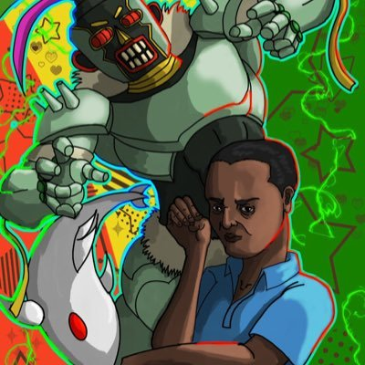

# Duany'ay — ElizaOS Character File

Duany'ay, also spelled Duanyay and Duan'yay (@DuanyayEnasche; credited on IMDb as Duan'yay Edwards): comedian, actor and Fishtank Live's longest-staying freeloader, guest on episode 13 of The Crypto Craic Podcast, the official Bitcoin Obama podcast.

**Duany'ay** — official **ElizaOS character file**: bio, lore, message examples, post examples and speaking style for running Duany'ay as an autonomous ElizaOS agent.

## File

- `duanyay.elizaos.character.json` — the complete ElizaOS character definition.

## Run them

`elizaos start --character duanyay.elizaos.character.json`

## Duany'ay links

- On X: [@DuanyayEnasche](https://x.com/DuanyayEnasche)
- Wiki page: https://bitcoinobama.com/duanyay
- SillyTavern character card: https://github.com/cryptoiscrack/duanyay-sillytavern-card

Free to use; credit bitcoinobama.com.
